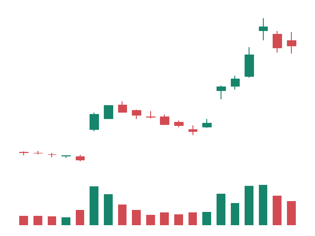
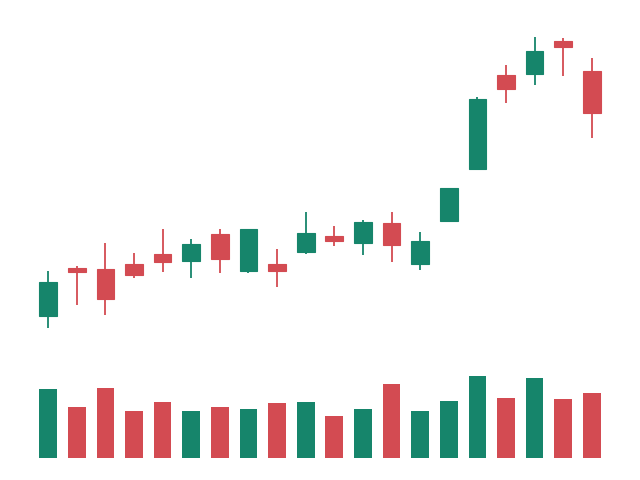
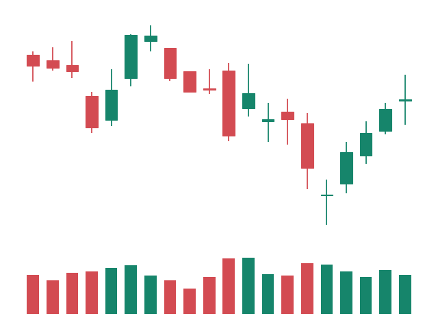

# Experiment 01: JEV-27B-VL on TSLA charts

## Question

Can JEV-27B-VL, zero-shot, predict next-five-trading-day direction (Up, Flat, Down) from unlabeled 20-day TSLA candlestick charts better than the majority-class base rate? Does it do better on TSLA than NVDA?

## Status

Stages 0-3 are complete. Historical real JEV predictions for all 252 charts, their mirrored placebos, and a 20-chart ticker probe are committed in `results/`. The original ten-chart fake-server run remains in `results/dry_run/` and is synthetic. Experiment 01 has no committed evaluation yet; the table below describes labels, not model accuracy. Later experiments and their corrected analyses are indexed in the repository README. The current review used only CPU work and did not start a pod.

## Reproduce Stages 1 and 2

Use Python 3.11 and run from this experiment directory:

```sh
python3.11 -m venv .venv
.venv/bin/python -m pip install -r requirements.txt
.venv/bin/python src/data.py --as-of 2026-10-09
.venv/bin/python src/render.py
.venv/bin/python -m unittest discover -s tests -v
```

`src/data.py` without `--as-of` defaults to the current New York date. The start defaults to 2024-01-01. Since yfinance's end date is exclusive, the script requests the next day. It conservatively omits an in-progress current session until 16:15 New York time. The [yfinance API documentation](https://ranaroussi.github.io/yfinance/reference/api/yfinance.download.html) defines the date and adjustment options.

Daily OHLC are explicitly adjusted (`auto_adjust=True`) so NVDA's split is handled consistently for charts and returns. Volume is the share count returned by Yahoo. Missing values, duplicate dates, nonfinite values, and malformed OHLCV stop the pipeline instead of being filled. Direct dependency versions are pinned in `requirements.txt`. All local caches are kept in this experiment directory.

## Chart and label method

Each image contains exactly 20 trading sessions of candlesticks plus volume. It is a 640 x 480 RGB PNG with a white background and no axes, ticks, dates, prices, ticker, labels, or text metadata. Price and volume scales depend only on the visible window. Chart filenames are anonymous sequential IDs.

Let `t` be the last visible session. The image uses rows `t-19` through `t`; the target is `r = close[t+5] / close[t] - 1`. The Flat threshold uses only completed historical five-session close returns:

```python
FLAT_BAND = 1 / 3
past_5d = close.pct_change(5, fill_method=None)
sigma = past_5d.rolling(60, min_periods=60).std(ddof=1)
threshold = FLAT_BAND * sigma.iloc[t]
```

The named constant `FLAT_BAND = 1 / 3` makes the Flat band one-third of the trailing five-session return standard deviation over the 60-session lookback. Flat means `abs(r) < threshold`. Otherwise the sign of `r` determines Up or Down; equality at the threshold is Up or Down. Undefined or zero volatility fails rather than inventing a label. The 60-return sample standard deviation needs 65 observed closes. The five-session stride is anchored to the first complete 20-session image (end position 19); warmup candidates are skipped until end position 64, and candidates without five future sessions are omitted. Only the past enters the image and its scales; future prices are used only for the target in the external index.

## Data and label results

Run cutoff: 2026-10-09. Each ticker has 696 daily sessions from 2024-01-02 through 2026-10-09. Eligible chart end dates run from 2024-04-04 through 2026-10-01.

| Ticker | Up | Flat | Down | Total charts | Majority class | Base rate |
| --- | ---: | ---: | ---: | ---: | --- | ---: |
| TSLA | 45 | 41 | 40 | 126 | Up | 35.71% |
| NVDA | 58 | 30 | 38 | 126 | Up | 46.03% |
| Combined | 103 | 71 | 78 | 252 | Up | 40.87% |

The majority-class base rate is the largest label count divided by the ticker's total chart count: the hit rate obtained by always predicting that class. For TSLA it is 45/126; for NVDA it is 58/126.

The brief's approximate 200 charts per ticker is larger than the exact date range and five-session stride allow. This run preserves those settings, the full volatility warmup, and the five-session outcome requirement, producing 126 per ticker.

Generated local inputs (ignored by Git):

- `data/TSLA.parquet` and `data/NVDA.parquet`: validated daily OHLCV.
- `data/manifest.json`: requested dates, actual sessions, download timestamp, yfinance version, and Parquet checksums.
- `charts/chart_*.png`: all 252 anonymous input charts.
- `charts/index.csv`: exactly `file,ticker,end_date,label,fwd_ret`; file paths are relative to this experiment directory.

Committed Stage 2 outputs:

- `results/label_counts.json`: per-ticker and combined label counts.
- `results/render_manifest.json`: rendering settings, input checksums, and chart date ranges.
- `results/samples/manifest.csv`: provenance, true labels, returns, and checksums for the three samples.

Samples are selected by fixed temporal positions without inspecting their labels: TSLA quarter, NVDA midpoint, TSLA three-quarter, using `floor((n-1) * fraction)`. They are copied byte-for-byte from the corresponding model-input PNGs. Captions below are documentation; the images contain no labels.

| Sample | Ticker | Chart end date | True next-five-day label |
| --- | --- | --- | --- |
| 1 | TSLA | 2024-11-13 | Flat |
| 2 | NVDA | 2025-07-01 | Up |
| 3 | TSLA | 2026-02-11 | Down |







## Stage 3: scoring client

Run from this experiment directory with the existing Python 3.11 virtual environment. `src/score.py` reads `charts/index.csv`, base64-encodes each PNG, and keeps true ticker, date, label, and return out of the inference payload. The default calls the model card's [System 1 decision endpoint](https://huggingface.co/autotrust/JEV-27B-VL#system-1-post-v1decide): `POST /v1/decide`, `kind="choice"`, image in `state`, `options=["Up","Flat","Down"]`, and `thinking="off"`. The question is exactly:

> This is a 20-day daily stock chart. Over the next 5 trading days, will the price go Up, stay Flat, or go Down?

The selectable `--api chat-logprobs` alternative uses the card's raw image template and the `jev-decision` LoRA. It reads A/B/C token logprobs, then applies the bundled decision-head biases and choice temperature. Those constants are sourced in `src/jev_api.py`; missing option logprobs fail. Both backends validate one finite probability per option and a sum of one.

### Future pod serving setup

These instructions are prepared for a later authorized GPU run. Use the planned Runpod network volume `jev-weights` in `US-MO-1`, mounted at `/workspace`, to persist `/workspace/models/JEV-27B-VL`. The model snapshot must include `serve.sh`, `serve_decide.py`, `adapter_vllm/`, and `calibration.json` as well as the weights. Use a compatible vLLM development build as required by the [serving notes](https://huggingface.co/autotrust/JEV-27B-VL#serving-notes); this CPU-only stage has not verified a pod's runtime or volume.

The existing `~/Desktop/runpod-setup/remote_serve.sh` starts plain vLLM without System 1. The replacement `scripts/remote_serve.sh` delegates to the model's [upstream launcher](https://huggingface.co/autotrust/JEV-27B-VL/blob/main/serve.sh), preserving the decision LoRA, processed-logprob mode, trusted image template, and required eight-sequence server cap. Prepare the local launcher with:

```sh
cp scripts/remote_serve.sh ~/Desktop/runpod-setup/remote_serve.sh
```

Copy that launcher to the existing pod as `/workspace/remote_serve.sh` using its Runpod Connect SSH instructions. After the complete model snapshot and compatible vLLM are installed on the pod, run this **on the pod**:

```sh
MODEL_DIR=/workspace/models/JEV-27B-VL PORT=8000 MAX_MODEL_LEN=8192 \
  bash /workspace/remote_serve.sh
```

Expose HTTP port 8000. Then run the scorer locally, substituting the actual pod ID:

```sh
cd ~/Desktop/WORK/ai-finance-experiments/01-jev-tsla-charts
JEV_BASE_URL="https://<POD_ID>-8000.proxy.runpod.net" \
  .venv/bin/python src/score.py --api decide \
  --batch-size 16 --concurrency 4 --timeout 60 --retries 3
```

This writes `results/preds.csv` with exactly `file,ticker,end_date,label,p_up,p_flat,p_down,latency_ms`. `latency_ms` includes image encoding, HTTP calls, and retry delays for that chart. Batch size bounds each client work group; concurrency bounds simultaneous single-image calls, allowing vLLM to batch them internally.

| CLI flag | Environment variable | Default |
| --- | --- | --- |
| `--base-url` | `JEV_BASE_URL` | Required |
| `--api` | `JEV_API` | `decide` |
| `--model` | `JEV_MODEL` | `jev-decision` for chat only |
| `--batch-size` | `JEV_BATCH_SIZE` | `16` |
| `--concurrency` | `JEV_CONCURRENCY` | `4` |
| `--timeout` | `JEV_TIMEOUT` | `60` seconds per HTTP attempt |
| `--retries` | `JEV_RETRIES` | `3` additional attempts |

CLI values override environment values. `--index`, `--results-dir`, and `--limit` support local subsets and separate runs; paths must stay inside this experiment. An optional `JEV_API_KEY` is sent as a Bearer token for a protected model endpoint. Keep credentials in the ignored `.env` and export them into the shell; the script does not automatically load `.env`. Runpod management keys are not required by the scorer.

Run the same command again to resume. Successful rows are flushed as they finish and skipped on restart; failed rows are retried. Torn or invalid probability rows are repaired. `results/score_errors.csv` records failures, attempt counts, mode, and API; a run with failures exits with status 1. The adjacent `*.meta.json` records hashes of the index and PNGs, the mode, prompt, API, and settings. Changing inputs or API requires a fresh `--results-dir`, preventing mixed runs. One process may write each prediction file at a time.

For the chat alternative, replace `--api decide` with `--api chat-logprobs --model jev-decision` after serving the same decision LoRA. Add `--placebo` to score horizontally mirrored PNGs in memory into `results/preds_placebo.csv`. Add `--ticker-probe` instead to ask which ticker the image shows, with TSLA/NVDA options, on 20 charts: ten evenly spaced dates per ticker, chosen without labels. It writes `results/ticker_probe.csv` with truth and predicted ticker, both probabilities, and latency. The two sanity modes are mutually exclusive and each resumes independently.

### CPU-only dry run

In one terminal:

```sh
.venv/bin/python tests/fake_jev_server.py --port 8765 --seed 17
```

In another terminal:

```sh
.venv/bin/python src/score.py --base-url http://127.0.0.1:8765 \
  --dry-run --limit 10 --batch-size 5 --concurrency 2 --timeout 10 --retries 1
```

The fake server returns random valid probabilities and only binds to loopback. `--dry-run` defaults to ten charts, permits only loopback endpoints, and separates synthetic outputs under `results/dry_run/`. No API key is sent. Committed `results/dry_run/preds.csv`, `preds.meta.json`, `score_errors.csv`, and `summary.json` document the ten-chart check on the actual rendered inputs: 10 successes, zero failures, and all 10 skipped on resume with zero extra HTTP requests. They are synthetic fixtures, never evidence of model accuracy. Stop the fake server with Ctrl-C when finished.

## Validation

The CPU suite now covers causal rendering, strict label boundaries, HTTP retries and resume, corrupt probabilities, option-token calibration, native/chat fixture agreement, server identity changes, new task definitions, blank and mirrored pixels, ticker probing, and copied scorers in experiments 02-04. Weekly tests cover holiday targets and zero/nonfinite volatility. Run `.venv/bin/python -m unittest discover -s tests -v`. Golden fixtures check the documented mathematics; actual HF-vLLM numerical equivalence still needs the gated real-model test described in Experiment 04.

## Limitations and next steps

Yahoo's adjusted history is retrospective and can be revised; it is not a point-in-time archive. Checksums identify this run's local data snapshots. Adjacent 20-session images overlap. The experiment is zero-shot, uses only TSLA and NVDA, and does not study trading P&L. Fine-tuning and extra tickers are out of scope.

Historical inference has already run; the new explicit-task and blank-image controls below have not. The historical prompt leaves Flat undefined, so old results must not be relabeled as results from the revised prompt. Adjacent windows overlap, and ticker-probe failure would not prove that the model cannot identify or memorize the source. No trading P&L claim is made.

## Revised scoring tasks and controls

`--task historical` preserves the old prompt. New runs must use a fresh results directory. The scorer now requests `/v1/decide/info`, validates the model, protocol and choice temperature, and pins identity in the resume fingerprint. If the server does not advertise a revision, provide `--model-revision` or `JEV_MODEL_REVISION` with the actual 40-character Hugging Face snapshot commit or 64-character weight hash. A caller-declared revision records provenance; it does not independently prove which weights the server loaded.

- `--task binary-direction` asks Up or Down only, derives truth from the return sign, excludes exactly zero returns and writes `preds_binary.csv` with `p_flat=0`.
- `--task ternary-volatility` states the precise Flat rule and the known volatility and threshold in each request, writing `preds_volatility.csv`. It requires a finite positive `sigma` column in the index. Experiment 01's original five-column index lacks sigma, so export a separately versioned index with causally computed sigma before using this task. Weekly experiment indexes already include it.
- `--blank` replaces pixels with white while retaining the same task/context. `--placebo` mirrors the image. Their outputs and error files are separate. Neither may be combined with the other or with `--ticker-probe`.
- `--window-sessions`, `--horizon`, `--vol-lookback` and `--flat-band` are part of the run fingerprint. Defaults here are 20, `next-5-trading-days`, 60 and 1/3; experiments 02-04 default to 5, `next-calendar-week`, 12 and 1/3.

For a later authorized real run, with an already running and revision-pinned server:

```sh
export JEV_BASE_URL="https://<POD_ID>-8000.proxy.runpod.net"
export JEV_MODEL_REVISION="<ACTUAL_HF_SNAPSHOT_COMMIT>"
.venv/bin/python src/score.py --task binary-direction --results-dir results/revised_binary
.venv/bin/python src/score.py --task binary-direction --blank --results-dir results/revised_binary
.venv/bin/python src/score.py --task binary-direction --placebo --results-dir results/revised_binary
```

The stored historical files predate the stricter fingerprint and should remain unchanged. Starting a revised run in a fresh directory avoids mixing identities or prompts. Serving still uses the `jev-weights` volume in `US-MO-1`, port 8000, and `~/Desktop/runpod-setup/remote_serve.sh` as described above.
