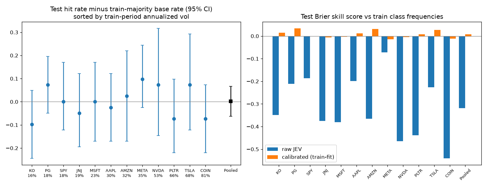
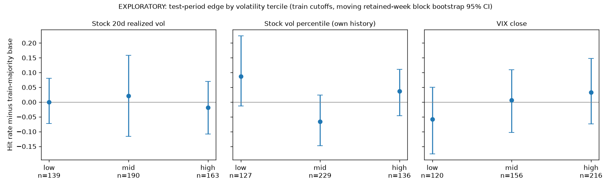

# Experiment 03: JEV on twelve tickers

Does pooling a broader set of weekly charts or calibrating JEV's probabilities help? Calibration reduced overconfidence, but the historical sample does not establish added predictive skill over a constant probability forecast.

## Design

Tickers: TSLA, NVDA, PLTR, COIN, AAPL, MSFT, AMZN, META, KO, JNJ, PG and SPY. Each has the same 2024-2026 adjusted-data window: 768 training charts and 492 test charts, across 64 and 41 dates respectively.

Charts show exactly one full Monday-Friday week. Holiday-shortened input weeks are excluded. The target is the next calendar week's last available close divided by the chart Friday close, minus one, including shortened target weeks. Flat means `abs(return) < (1/3) * sigma`, where sigma is the sample standard deviation of the last 12 completed weekly returns ending at the chart Friday. Equality is directional. Nonfinite or nonpositive sigma now raises an error; existing real labels are unchanged.

The split is by date: 64 training chart weeks per ticker from 2024-04-05 through 2025-10-03; the week ending 2025-10-10 is omitted; 41 test weeks run from 2025-10-17 through 2026-10-02. Input and target boundaries were checked for overlap. Historical JEV used an unlabeled, independently scaled 640 x 480 image with the question: "This is a 5-day daily stock chart covering one trading week. Over the next week, will the price go Up, stay Flat, or go Down?" That prompt did not define Flat or supply volatility.

The 210 TSLA/NVDA images reused from Experiment 02 were verified byte-identical with matching labels. Other charts and mirrored controls were scored through System 1. `results/predictions.csv` retains labels, raw and calibrated probabilities, volatility features and source provenance. Calibration is multinomial logistic regression on log probabilities, fitted only on pooled training rows.

## Corrected historical results

CIs use paired circular moving blocks of four consecutive retained forecast weeks, carrying all tickers in a date together. JSON also reports block lengths 1, 2 and 8, paired Brier/accuracy differences, and date-level sign-flip tests. Holiday gaps mean four retained dates can span more than four calendar weeks. Blocks address dependence approximately; stationarity is an assumption, and sign-flip tests additionally assume independent symmetric date differences. Exact enumeration does not remove those assumptions.

The primary references are selected or fitted on training labels. Test-majority rates are descriptive look-ahead benchmarks only, with no CI or success claim based on them. All historical results are exploratory because the test period informed successive experiments. Intervals remain unadjusted and exploratory. Selected families have Holm-adjusted p-values: four volatility coefficients in 03, and six model pairs across two metrics in 04. These limited adjustments do not correct the broader adaptive research process.

| Ticker | Raw hit | Train-selected base | Hit minus base 95% CI | BSS | Calibrated hit |
| --- | ---: | ---: | --- | ---: | ---: |
| TSLA | 0.439 | 0.366 | [-0.122, +0.293] | -0.226 | 0.341 |
| NVDA | 0.317 | 0.244 | [-0.146, +0.317] | -0.465 | 0.415 |
| PLTR | 0.268 | 0.341 | [-0.220, +0.098] | -0.439 | 0.268 |
| COIN | 0.293 | 0.366 | [-0.220, +0.073] | -0.540 | 0.317 |
| AAPL | 0.439 | 0.463 | [-0.171, +0.122] | -0.198 | 0.415 |
| MSFT | 0.317 | 0.317 | [-0.171, +0.171] | -0.380 | 0.244 |
| AMZN | 0.390 | 0.366 | [-0.171, +0.220] | -0.365 | 0.415 |
| META | 0.439 | 0.341 | [-0.024, +0.244] | -0.073 | 0.366 |
| KO | 0.366 | 0.463 | [-0.244, +0.049] | -0.349 | 0.415 |
| JNJ | 0.366 | 0.415 | [-0.195, +0.122] | -0.375 | 0.390 |
| PG | 0.415 | 0.341 | [-0.049, +0.195] | -0.212 | 0.317 |
| SPY | 0.415 | 0.415 | [-0.122, +0.171] | -0.187 | 0.390 |
| Pooled | 0.372 | 0.370 | [-0.063, +0.067] | -0.318 | 0.358 |

The pooled training-frequency forecast needs neither image nor ticker identity: test hit 0.380, Brier 0.663186. Raw JEV Brier is 0.877935; calibrated Brier is 0.661129. The small calibrated improvement over the constant forecast has an interval including zero. Raw JEV predicts Flat on only 2 of 492 test charts. Calibration coefficients shrink predictions close to class priors; reduced overconfidence is distinct from demonstrated chart information.

## Exploratory volatility analyses

`results/metrics.json` retains cross-ticker correlations, train-defined volatility terciles, and a correctness logit with ticker effects and date-clustered errors. Features are rv20, its causal within-ticker historical percentile, VIX close and SPY rv20. Many comparisons remain unadjusted; the four logit coefficients additionally report Holm-adjusted p-values. Date-clustered errors handle contemporaneous dependence but do not by themselves handle serial dependence. Regime plots now use moving-block intervals; no regime finding establishes a robust forecasting advantage.

## Reproduce and limitations

Install `requirements.txt`, retain the local `charts/index.csv`, and run `python src/evaluate.py` to regenerate CPU metrics and figures from historical artifacts. Raw prediction CSVs were preserved during the correction. Revised explicit-Flat/binary prompts and blank-image controls are available in `src/score.py`, documented in Experiment 01, and need fresh output directories and new real-model inference. They have not been run.

These are 41 retained dates, not 492 independent observations. Dates may also be serially dependent. The hand-selected surviving tickers, retrospective adjusted prices, one reused test year, ambiguous historical prompt and rescaled images limit interpretation. No P&L or general claim about the informativeness of charts follows. Experiment 05 extends history and tests cheap numerical baselines under a separate frozen protocol.
