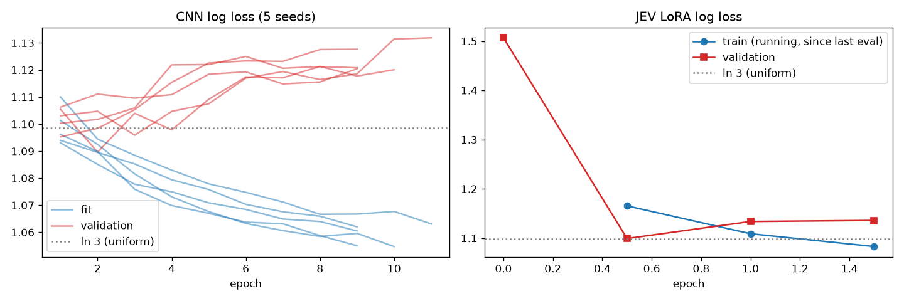
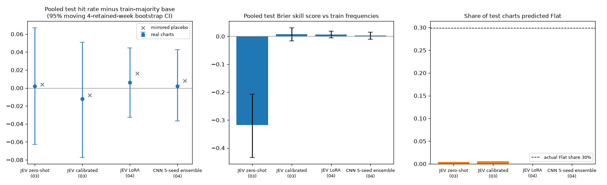

# Experiment 04: JEV LoRA and CNN

Do task-specific training recipes improve weekly direction forecasts? The historical LoRA and CNN runs did not establish added skill over a simple probability prior. This finding is limited to the tested settings.

## Historical design and audit

The 12 tickers, images, labels and outer split match Experiment 03. Canonical training partitions are 612 fit charts across 51 dates, 156 validation charts across 13 dates, and 492 test charts across 41 dates. Targets must finish before the next partition's first input week. Validation chooses checkpoints; test labels never select them.

Historical LoRA used JEV's decision adapter merged into the base, then a new rank-16 adapter (108.8 million trainable parameters), learning rate 1e-4 and accumulation 8. The best checkpoint was at half an epoch: validation log loss 1.0991, near uniform's 1.0986. CNN results average five seeds. Historical curves and predictions are retained.

**The old HF-vLLM comparison differed by up to 0.151833 in option probability and did not stop training.** Consequently, old LoRA-versus-vLLM differences are not a verified controlled implementation comparison. The new gate fixes the workflow; it does not retroactively validate that run. No record of the old full GPU package environment or saved CNN weights was recovered.



## Corrected historical results

CIs use paired circular moving blocks of four consecutive retained forecast weeks, carrying all tickers in a date together. JSON also reports block lengths 1, 2 and 8, paired Brier/accuracy differences, and date-level sign-flip tests. Holiday gaps mean four retained dates can span more than four calendar weeks. Blocks address dependence approximately; stationarity is an assumption, and sign-flip tests additionally assume independent symmetric date differences. Exact enumeration does not remove those assumptions.

The primary references are selected or fitted on training labels. Test-majority rates are descriptive look-ahead benchmarks only, with no CI or success claim based on them. All historical results are exploratory because the test period informed successive experiments. Intervals remain unadjusted and exploratory. Selected families have Holm-adjusted p-values: four volatility coefficients in 03, and six model pairs across two metrics in 04. These limited adjustments do not correct the broader adaptive research process.

| Model | Hit | Hit minus ticker train base 95% CI | Mirrored hit | Brier | BSS vs ticker prior | Up/Flat/Down predictions |
| --- | ---: | --- | ---: | ---: | ---: | --- |
| JEV zero-shot (03) | 0.372 | [-0.063, +0.067] | 0.374 | 0.877935 | -0.318 | 254/2/236 |
| JEV calibrated (03) | 0.358 | [-0.077, +0.051] | 0.362 | 0.661129 | +0.007 | 289/3/200 |
| JEV LoRA (04) | 0.376 | [-0.033, +0.045] | 0.386 | 0.661842 | +0.006 | 490/0/2 |
| CNN 5-seed ensemble (04) | 0.372 | [-0.037, +0.043] | 0.378 | 0.664412 | +0.002 | 486/0/6 |

The pooled training-frequency baseline scores 187/492 = **38.01%**, with Brier **0.663186**. Always-Up has the same accuracy but much worse Brier, so deterministic accuracy and probabilistic skill must be distinguished. None of the calibrated/trained models has a positive Brier improvement over the pooled constant whose four-week interval excludes zero. Paired head-to-head comparisons, block-length sensitivity and per-seed results are in `results/metrics.json`.

LoRA versus mirrored images has **0 wins, 5 losses and 487 ties**, with the five losses on five different dates. The exact two-sided date-sign-flip result is **p = 0.0625**. The previous “significantly below placebo” claim was unsupported: its percentile-bootstrap interval excluded zero despite only five discordant dates. Mirroring is also weak evidence when a model predicts Up almost always.



## Reproducible training preparation

Run commands from `04-jev-lora-and-cnn` in a Python 3.11 environment with `requirements.txt` installed. Preparation and evaluation require the preserved local data/chart snapshot, including ignored `charts/index.csv`; a fresh clone does not contain it.

These changes were tested on CPU. No new CNN optimization, HF model execution or pod launch was performed. The local bundle has 1,260 verified chart identities and 69 representative fit-only parity fixtures, covering tickers, available classes and dates.

```sh
python src/prepare_training.py
python -m unittest discover -s tests -v
```

`data/training_bundle/` contains the canonical split index, copied images, reference probabilities, parity fixtures and a manifest of input, code and package hashes. `verify_bundle` rejects altered identities, files, splits or fixtures. Historical bundles are explicitly marked as having unverified old server identity.

Training dependencies are separate: `requirements-training-cnn.txt` pins PyTorch 2.14.1 and torchvision 0.29.1. `requirements-training-lora.txt` additionally pins transformers 5.19.0, peft 0.21.2, safetensors 0.8.0 and accelerate 1.15.0. These are a **candidate environment**, not a recovered old runtime or a GPU-validated compatibility claim. Python 3.11 is required. Local preflight correctly stops on missing HF packages before importing torch or allocating a model.

A corrected ternary experiment first needs fresh vLLM references collected with matching task settings, revision, images and questions. With a later authorized, already running server:

```sh
python src/score.py --task ternary-volatility --results-dir results/revised_reference
python src/score.py --task ternary-volatility --blank --results-dir results/revised_reference
python src/score.py --task ternary-volatility --placebo --results-dir results/revised_reference
python src/prepare_training.py --task ternary-volatility   --reference results/revised_reference/preds_volatility.csv   --reference-metadata results/revised_reference/preds_volatility.meta.json   --out data/training_bundle_ternary
```

Set `JEV_BASE_URL` and the actual `JEV_MODEL_REVISION` as described in Experiment 01. Preparation rejects historical references supplied as revised task outputs. Keep binary-direction scoring a separate study; this trainer is three-class only.

On a separately authorized compatible CUDA machine, with the complete local JEV snapshot and exported bundle:

```sh
python -m pip install -r requirements-training-lora.txt
python src/lora_train.py --mode preflight --data data/training_bundle_ternary --model-dir /workspace/models/JEV-27B-VL
python src/lora_train.py --mode parity --data data/training_bundle_ternary --model-dir /workspace/models/JEV-27B-VL
python src/lora_train.py --mode train --data data/training_bundle_ternary --model-dir /workspace/models/JEV-27B-VL
```

The default mode is CPU preflight. Parity and training are explicit GPU operations. Training stops if any fit-only fixture differs from its matching vLLM reference by more than **0.01** absolute probability; the CLI cannot loosen that limit. Resolve failures without tuning on test rows. Before fine-tuning, save HF zero-shot validation, test and mirrored-test probabilities from the same inference path. Full and partial accumulation groups average by their actual size. Outputs default to `results/revised_training/`, preserving historical files. Checkpoints record model, runtime and input hashes. The on-save LoRA check reloads the new adapter onto the same merged base and requires probabilities to match within 1e-7; this verifies adapter serialization. A separate fresh-process reload reconstructs the original base/decision merge and checks the bound bundle, task and weight hashes before loading the adapter. Its actual GPU probability equivalence remains unverified.

For the CNN, first install `python -m pip install -r requirements-training-cnn.txt`. Then `python src/cnn.py --device cpu --out results/revised_cnn` explicitly trains all five seeds on CPU. Each checkpoint is saved and reloaded before predictions. CPU tests verify random-weight round trips without training. To reload a saved checkpoint, use `--checkpoint <PATH> --checkpoint-sha256 <SHA256> --device cpu --out <FRESH_DIRECTORY>`.

LoRA reload on an authorized CUDA machine:

```sh
python src/lora_reload.py --model-dir /workspace/models/JEV-27B-VL   --checkpoint results/revised_training/lora_r16 --data data/training_bundle_ternary   --out results/reloaded/lora_test.csv --split test
```

CPU historical evaluation remains `python src/evaluate04.py`. The new blank-image inference, actual parity pass and revised training remain unexecuted. Fixing task definition and reproducibility may change results; it does not promise a forecasting edge. One adaptive historical test year cannot establish that all chart signals are absent.
