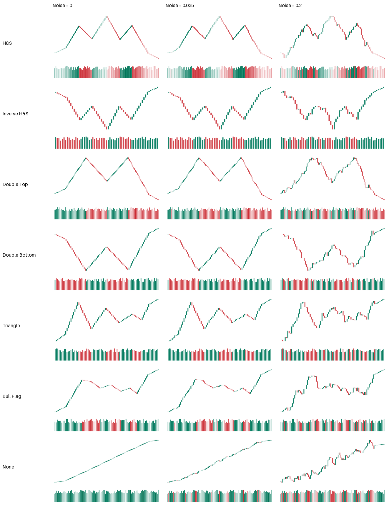
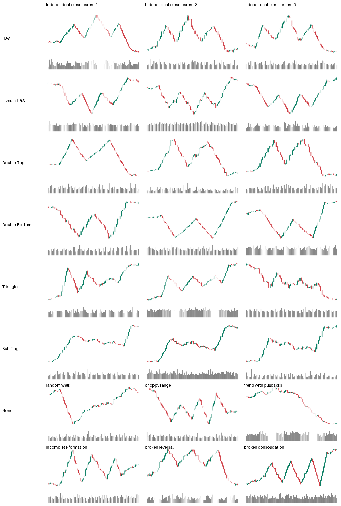

# Experiment 06b: chart-pattern recognition

This CPU dataset prepares a visual-recognition test for **[autotrust/JEV-27B-VL on Hugging Face](https://huggingface.co/autotrust/JEV-27B-VL)**. No model inference, GPU session, or Runpod resource is started. Day 2 adds a small detector-agreement real-market feasibility set, documented below.

Protocol **v3**, seed **60618**, replaces the original generator's overly simple None paths and deterministic nuisance cues. Its [parameters and geometric rules](protocol.json) record the initial revision, a failed intermediate classifier check, and the final negative-family design fixed before a second, freshly seeded confirmation check. The 200 parent templates each receive five paired corruptions, producing 1,200 images at 1024 × 640 with 60–120 candlesticks and volume. Scored images contain no text.

| Source class | Clean parents | Noisy variants | Total |
|---|---:|---:|---:|
| Head and Shoulders | 29 | 145 | 174 |
| Inverse Head and Shoulders | 29 | 145 | 174 |
| Double Top | 29 | 145 | 174 |
| Double Bottom | 29 | 145 | 174 |
| Triangle | 28 | 140 | 168 |
| Bull Flag | 28 | 140 | 168 |
| None | 28 | 140 | 168 |
| **All** | **200** | **1,000** | **1,200** |

None now comprises **5 random walks, 5 choppy ranges, 5 trends with random pullbacks, 5 incomplete formations, 4 broken reversals, and 4 broken consolidations**. The latter families include triple tops/bottoms and unequal double peaks/troughs, diverging bounds, and rising consolidations that fail the defined downward Bull Flag rule. They can have completed-looking exits, so an absent breakout is not a universal negative cue. This six-family mixture was fixed for coverage before its classifier results. A frozen screen rejects obvious completed whole-window target shapes in their source control points; the primary dataset rejected one candidate path. The screen is deliberately limited to synthetic control paths, and does not implement Day 2's real-data detector or establish that every image lacks an incidental local pattern. Acceptance never uses the leakage classifier's output.

Every family uses the same independent distributions for bar count, nominal price, target volatility, microtexture, candle gaps/wicks, and volume. Each clean parent's sample standard deviation of daily **log returns** is scaled exactly to an independent log-uniform draw between 0.004 and 0.018. This matches the population distribution rather than assigning identical finite-sample values to every class. [Population statistics](results/population_stats.json) report the realized per-class ranges and medians, lengths, positions, and margin directions.

Positive patterns vary pivot timing, height, neckline tilt, shoulder asymmetry, channel width/slope, and triangle subtype within their geometric definitions. Shared daily microtexture is added to every clean family, including None. Pattern location and both margins vary independently: each margin spans 10–20% of the pattern length, and its direction is unrelated to the class or preceding segment. A separately seeded volume process uses **neutral gray bars**, so volume colors cannot duplicate the price direction. Clean positive parents retain a completed break and stay beyond it through the right margin.

“Clean” means **no added corruption**; it does not mean a perfectly smooth line. The five added levels are **0.035, 0.08, 0.16, 0.30, and 0.55** times the clean log-price range. Each parent reuses one global Brownian bridge, pinned only at the chart endpoints. Major pivots and even apparent completion can disappear at high noise. Labels identify the source family, not a claim that a severely corrupted picture still clearly exhibits it. All six versions retain `template_id` and remain together in confidence intervals or paired analyses.

The [noise grid](results/samples/synthetic_grid.png) shows the first parent of every class at levels 0, 0.08, and 0.55. The [clean-diversity grid](results/samples/clean_diversity_grid.png) shows the first three independently drawn parents per positive class and the first six None parents, covering all six negative families in two rows. Selection rules were fixed before viewing. The seven individual clean examples remain `results/samples/sample_01.png` through `sample_07.png`. Grid captions are review aids and never enter scored images.





From the repository root, using the separate pinned Experiment 06 environment:

```sh
06-jev-patterns/.venv/bin/python 06-jev-patterns/06b-chart-patterns/src/synth.py
06-jev-patterns/.venv/bin/python 06-jev-patterns/06b-chart-patterns/src/leakage_audit.py
06-jev-patterns/.venv/bin/python -m unittest discover -s 06-jev-patterns/tests -p 'test_synthetic*.py' -v
```

Exports include ignored `data/bars/*.csv`, ignored `charts/*.png`, and ignored `charts/index.csv`. Committed `results/synthetic_index.csv` duplicates the scorer index; counts, population statistics, and the render manifest preserve seeds, pivots, breaks, data/image hashes, and protocol/generator/renderer/context hashes. CSV dates are artificial coordinates required by the shared renderer: `ticker=SYNTH`, index `end_date` is blank, and no historical inference is valid.

## Numeric shortcut regression check

The 200 evaluation parents have no training split. The [CPU audit](src/leakage_audit.py) fits only separate cohorts of **1,400 clean parents**, each split into 840 training and 560 held-out parents, stratified over seven source classes. Each held-out cohort contains 80 None and 480 positive patterns. No audit parent seed overlaps the primary 200, the other audit cohort, or the opposite split; noise/style siblings never cross partitions. Inputs are only visible numeric OHLCV, with 32 normalized close positions and fixed shape/nuisance statistics.

Before inspecting revised-generator outcomes, we fixed a standardized class-balanced logistic regression (`C=1`) and a class-balanced 200-tree forest (`max_depth=4`, `min_samples_leaf=10`). Each must stay **strictly below 90% held-out balanced accuracy** for None versus any declared pattern. Balanced accuracy averages the two class recalls; ordinary accuracy would reward the 6:1 positive-class imbalance. Always guessing pattern already scores 85.71% ordinary accuracy and 50% balanced accuracy.

| Generator / cohort | Logistic balanced accuracy | Forest balanced accuracy | Forest ordinary accuracy |
|---|---:|---:|---:|
| Original generator | 100.00% | 100.00% | 100.00% |
| Intermediate v2 | 78.44% | 95.42% | 98.39% |
| Final v3 regression | 63.44% | 86.35% | 93.57% |
| Final v3 fresh confirmation | 67.50% | 88.13% | 94.82% |

The intermediate forest failure motivated the rule-defined hard negatives. [Development history](results/leakage_development_history.json) retains that failure and the original-generator result. The reused cohort (`20261017`, split `1701`) is a regression check after adaptation, not an untouched holdout. A second cohort (`20261023`, split `2301`) was declared before evaluating v3; the features, classifiers and pass limits stayed unchanged. The [final report](results/leakage_audit.json) contains both cohorts, confusion matrices, source hashes and complete configuration. Tests enforce both gates on both cohorts and include a deliberately leaky fixture that must fail.

These are conditional regression guards, **not proof of zero leakage or model quality**. Strong geometry-based separation can be legitimate; the fresh forest still has 95.44% ROC AUC. Shared nuisance distributions alone do not guarantee identical finite-sample realizations. No real JEV inference or pattern-baseline training on the primary evaluation set has run.

The prepared fixed-100 control interpolates each same template/noise realization onto 100 bars. Generate it in a separate ignored directory:

```sh
06-jev-patterns/.venv/bin/python 06-jev-patterns/06b-chart-patterns/src/synth.py \
  --fixed-bars 100 --output-dir 06-jev-patterns/06b-chart-patterns/data/fixed_100
```

The primary Day 1 set does not generate this optional control. Day 2 real-data framing must use genuine fixed historical windows instead. Shared rendering also supports OHLC/line variants and horizontal mirrors. A horizontal mirror reverses **time**, not prices; it does not exchange H&S with Inverse or Double Top with Double Bottom, contrary to the preserved planning note. Price inversion creates those counterparts.


## Day 2 real-market dataset

The frozen scan covered all **50 tickers**, adjusted daily OHLCV from **2005-01-01 through 2026-09-30** (or IPO), using the Day 1 snapshots. The actual result is **150 real parents: 82 train and 68 test**, each rendered twice. All six positive classes miss the 80–120 target. No rule was relaxed to fill a quota. Inverse H&S, Double Top and Double Bottom have **no test examples**. This is a small, imbalanced feasibility set; it cannot support a seven-class held-out recognition claim.

### External detector, license and independent check

[BennyThadikaran/stock-pattern at revision 85c710d](https://github.com/BennyThadikaran/stock-pattern/tree/85c710daa5809f8f85c9e6f3f98ceea200317566) provides all six required functions in [src/utils.py](https://github.com/BennyThadikaran/stock-pattern/blob/85c710daa5809f8f85c9e6f3f98ceea200317566/src/utils.py): `find_hns`, `find_reverse_hns`, `find_double_top`, `find_double_bottom`, `find_triangles`, and `find_bullish_flag`. Its [LICENSE](https://github.com/BennyThadikaran/stock-pattern/blob/85c710daa5809f8f85c9e6f3f98ceea200317566/LICENSE) is **GPL-3.0**. We use the public detector for this research scan; its unmodified source and license are downloaded into ignored `.cache/`, checksum-verified, and not vendored. This is not a claim that an ignored cache removes upstream licensing obligations. The revision and SHA-256s are recorded in [real_rules.json](config/real_rules.json).

The external functions propose pre-breakout structures. Our adapter scans every historical 120-bar prefix and confirms a close beyond the proposed boundary within the next 15 available bars, with a 0.1 ATR buffer. Confirmation is included in the visible chart. An exact vectorized cache preserves upstream pivot semantics—including its actual 7-left/5-right center—verified against the original function.

The [independent detector](src/zigzag_detector.py) consumes closing prices and causal ATR-scaled directional changes directly. It does not consume upstream pivots, candidates, volume tests or algorithms. Reversal scales are 1.5/2.5 ATR with a minimum 0.8% move; adjacent turns are at least three bars apart. Normalized tolerances include peak mismatch <=20% of height, shoulder mismatch <=25%, head prominence >=12%, neckline tilt <=25%, and minimum height 2.5 ATR. Triangles must narrow to <=70% of initial width; a separately fitted downward flag channel follows a >=4 ATR pole, retraces <=50%, and has residual width <=40% of the pole. Breakout clearance is 0.15 ATR. The complete rules, timing and bounds are in the config.

Agreement pairs same-class completed events one-to-one within five bars, with span intersection-over-union >=0.5. We reject competing classes near the completion (within ten bars and span IoU >=0.3), and require both detector boundaries to remain broken at the final chart bar. “Single-label” means one agreed main formation under this explicit exclusion rule; small incidental shapes may remain.

| Class | Eligible train / test | Selected train / test | Total | Event agreement |
|---|---:|---:|---:|---:|
| Head and Shoulders | 5 / 1 | 5 / 1 | 6 | 6.60% |
| Inverse Head and Shoulders | 2 / 0 | 2 / 0 | 2 | 5.97% |
| Double Top | 1 / 0 | 1 / 0 | 1 | 2.11% |
| Double Bottom | 1 / 0 | 1 / 0 | 1 | 2.48% |
| Triangle | 1 / 3 | 1 / 3 | 4 | 1.27% |
| Bull Flag | 24 / 16 | 22 / 14 | 36 | 3.38% |
| None | 318 / 188 | 50 / 50 | 100 | 2.90%* |

Positive agreement is **matched / (external + independent − matched)** before framing, exclusivity, split and sample filters. Raw detector/matched totals are H&S 102/221/20; inverse 119/236/20; top 46/487/11; bottom 52/610/16; triangle 65/1,774/23; flag 293/4,106/144. This deliberately differs from reporting 100% on the already-filtered agreements.

*None uses the union of negative decisions on 23,113 prespecified 120-bar absence-screen windows: external negative 17,352, independent negative 617, both negative 506. Its denominator is different from positive events. These disagreements reflect different definitions/sensitivity and do **not** measure expert label accuracy. There were **zero upstream exceptions**. [Counts](results/real_label_counts.json), [agreement/exclusions](results/real_agreement.json), and [selected event details](results/real_selection_details.json) preserve the full audit.

### Splits, framing and review

Train ends by 2018-12-31; January–March 2019 is embargoed; test inputs begin on/after 2019-04-01. Both rendered windows and detector input history must fit one split. Selection is deterministic, rare-class-first, then ticker/year round-robin, targeting 50 per split. No two selected real 06b windows share a trading session for the same ticker, considering the union of variable and fixed framing. Within-parent versions are intentionally paired.

Positive variable frames use the agreed start through completion with nominal 15% padding on each side (10–20% after rounding/minimum-length adjustment), 60–120 bars, 1024×640. To fit the complete formation in the paired genuine 100-session chart with the same end date, accepted pattern spans are 44–86 bars. These joint framing requirements explain much of the scarcity. The fixed real version uses actual historical bars; it is never interpolated.

None is screened for absence of either detector's completed events over 120 sessions. Its variable lengths are drawn deterministically from pooled eligible positive lengths **within the same split**, avoiding a fixed-length None shortcut. The initial CPU feasibility run used constant-length None frames; [real_feasibility_v1.json](results/real_feasibility_v1.json) preserves its counts/rates. Only None screening/framing changed before inference; positive detector tolerances and sampling targets did not.

The seven [review grids](results/samples/real) each have **12 slots**, with available examples followed by explicit empty slots for rare classes. They show 6 H&S, 2 inverse, 1 top, 1 bottom, 4 triangles, 12 flags and 12 None examples. Repeating or inventing examples would hide scarcity. Captions and asterisks occur only in review grids, never scored PNGs.

**143/150 have heuristic warning flags:** 43/50 positives for small/weak/asymmetric geometry or completion disagreement, plus all 100 None rows for uncertain taxonomy absence. This is **not a visual-audit failure rate**. The [review manifest](results/samples/real/review_manifest.json) records selection, IDs and reasons. [AI visual notes](results/samples/real/ai_visual_notes.md) describe the inspected grids; user review remains pending. The 06a empirical audit stays 10/50 subtle; it does not transfer to these real 06b charts.

Reproduce from the repo root after restoring the exact Day 1 snapshots:

```sh
06-jev-patterns/.venv/bin/python 06-jev-patterns/06b-chart-patterns/src/external_detector.py --fetch
06-jev-patterns/.venv/bin/python 06-jev-patterns/06b-chart-patterns/src/detect_patterns.py --workers 4
# Rebuild selection/rendering only from checksum-matched local scan caches:
06-jev-patterns/.venv/bin/python 06-jev-patterns/06b-chart-patterns/src/detect_patterns.py --reuse-scan
```

[real_index.csv](results/real_index.csv) and [real_fixed100_index.csv](results/real_fixed100_index.csv) retain matching parent IDs. The [render manifest](results/real_render_manifest.json) pins raw data, code, rules, CSVs and all 300 image/bars pairs. Raw bars, scan caches and chart PNGs remain ignored; selected review grids and provenance are committed.
