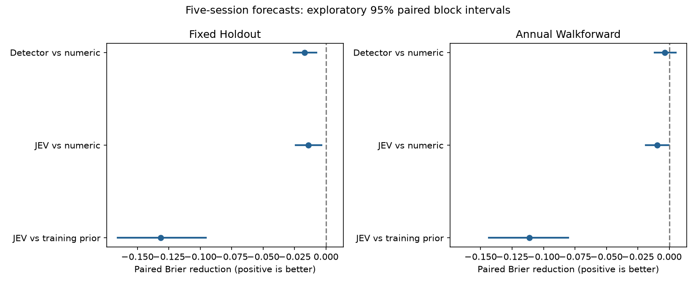

# CPU forecasting bridge v1

This evaluates **next-five-session Up/Flat/Down forecasts**, using recorded JEV pattern probabilities as features. It does not measure pattern-recognition accuracy.

The protocol and implementation were committed before this return evaluation. This is a retrospective, pattern-balanced cohort, not independent confirmation or a naturally sampled trading population.

Eligible cohort: **1182 rows**; {'test': 598, 'train': 584}. Exclusions: {'insufficient_trailing_history': 14, 'missing_forward_target': 1, 'train_target_after_boundary': 3}.

## Forecast metrics

| Evaluation | Model | N | Accuracy | Macro-F1 | Brier ↓ | Log loss ↓ |
| --- | --- | ---: | ---: | ---: | ---: | ---: |
| fixed_holdout | pooled_train_prior | 598 | 39.63% | 0.189 | 0.658871 | 1.086870 |
| fixed_holdout | uniform | 598 | 39.63% | 0.189 | 0.666667 | 1.098612 |
| fixed_holdout | A_numeric | 598 | 34.78% | 0.331 | 0.776384 | 1.309344 |
| fixed_holdout | B_detector | 598 | 32.27% | 0.308 | 0.793376 | 1.339526 |
| fixed_holdout | C_jev | 598 | 33.44% | 0.319 | 0.790343 | 1.334568 |
| annual_walkforward | pooled_train_prior | 598 | 39.63% | 0.189 | 0.659010 | 1.087043 |
| annual_walkforward | uniform | 598 | 39.63% | 0.189 | 0.666667 | 1.098612 |
| annual_walkforward | A_numeric | 598 | 32.61% | 0.312 | 0.760502 | 1.264201 |
| annual_walkforward | B_detector | 598 | 33.44% | 0.322 | 0.764061 | 1.270613 |
| annual_walkforward | C_jev | 598 | 33.28% | 0.323 | 0.770202 | 1.278881 |

## Paired comparisons

Positive Brier reduction means the left model improves. Intervals use 2,000 circular moving-block draws of four consecutive retained forecast-week clusters; all dates/tickers in a week stay together. Other block lengths and annual results are in metrics.json.

| Evaluation | Comparison | Brier reduction | 95% interval | Accuracy change (pp) | Years with positive Brier reduction |
| --- | --- | ---: | --- | ---: | ---: |
| fixed_holdout | B_detector_vs_A_numeric | -0.016992 | [-0.025866, -0.007835] | -2.51 | 2/8 |
| fixed_holdout | C_jev_vs_A_numeric | -0.013959 | [-0.024287, -0.003695] | -1.34 | 1/8 |
| fixed_holdout | A_numeric_vs_pooled_train_prior | -0.117513 | [-0.149820, -0.083714] | -4.85 | 0/8 |
| fixed_holdout | C_jev_vs_pooled_train_prior | -0.131472 | [-0.165791, -0.095575] | -6.19 | 0/8 |
| annual_walkforward | B_detector_vs_A_numeric | -0.003558 | [-0.011586, 0.005136] | +0.84 | 3/8 |
| annual_walkforward | C_jev_vs_A_numeric | -0.009699 | [-0.018551, -0.000451] | +0.67 | 1/8 |
| annual_walkforward | A_numeric_vs_pooled_train_prior | -0.101492 | [-0.133050, -0.072501] | -7.02 | 0/8 |
| annual_walkforward | C_jev_vs_pooled_train_prior | -0.111191 | [-0.143422, -0.080361] | -6.35 | 0/8 |

## Frozen continuation decision

**Continuation criteria not met: no demonstrated case for additional JEV compute from this study.**

- primary_paired_ci_above_zero: failed
- primary_C_brier_below_train_prior: failed
- walkforward_C_vs_A_improvement_positive: failed

## Interpretation and limitations

- A uses 160 normalized visible OHLCV grid features plus eight visible-window summaries. B adds detector-label indicators; C adds the full eight-option JEV definitions probability vector. Separate fixed logistic models forecast returns; JEV was not asked to predict returns here.
- Fixed holdout fits only the original pre-2019 training rows. Annual walk-forward refits on preceding observations; earlier test years become training history. Every training target precedes the earliest test information window, including the trailing target-scale history.
- JEV's definitions arm was selected after reviewing recognition performance; return evaluation choices were frozen before this run. Historical periods and the hand-selected surviving universe have already informed research, so these findings are exploratory. JEV pretraining overlap is unknown.
- Pattern-balanced sampling, sparse year/ticker coverage and limited training size restrict generalization. This is a fixed linear baseline comparison, not a claim about all numeric or vision models. A negative detector result does not logically rule out other JEV features.
- Bootstrap intervals condition on fitted predictions, approximate stationarity and the retained-week block construction. Sparse gaps span more calendar time; intervals have no multiplicity correction. Refit uncertainty is not included.
- Existing v7 probability noise and post-hoc repeatability-policy changes carry forward. No robustness control predictions were added. No costs, execution, turnover or net P&L were tested; adjusted close-to-close targets are a research convention.
- No GPU, Runpod operation, HTTP inference or market-data download was used. Exp05's prospective holdout and frozen models remain unchanged.

## Reproduction

From the repository root with the ignored frozen market snapshots and visible bars restored:

```sh
06-jev-patterns/.venv/bin/python 06-jev-patterns/shared/src/forecast_bridge.py
```

Protocol SHA-256: 1e4bcdb8a96bb5ef86d19c56a64f621b0deb203ab40d95f38954c2c838173892. Code SHA-256: 07df2563231671414e7b73056021b3acc33e17cb704434ebe2caf88fa426a0ec.
See [metrics.json](metrics.json), [manifest.json](manifest.json), [folds.json](folds.json), [predictions.csv](predictions.csv), [cohort.csv](cohort.csv), and [exclusions.csv](exclusions.csv).

## Review and validation

JEV features worsen Brier relative to numeric A in both evaluations and improve annual Brier in only 1/8 years. Every fitted model also underperforms the training-frequency prior. The fixed high-dimensional logistic comparison and small pattern-balanced sample limit generalization; the outcome supports pausing this tested route, not declaring all chart information useless.



[Independent validation](validation.json) recomputes all 1,182 forward targets/trailing scales and ten metric summaries, checks nine purged folds, 27 checkpoint records and artifact hashes. The implementation/protocol freeze is [f780579](https://github.com/mcravi8/mcravi8-lab/commit/f780579), recorded in the manifest. A later CI test-only correction replaces bitwise repeated-fit equality with the already declared 1e-12 CPU tolerance plus identical argmaxes: Linux showed a maximum rounding difference of 5.55e-16. No scientific setting, implementation, target, prediction or result was changed.

Uniform-probability argmax ties select Up, so its 39.6% accuracy reflects this cohort's Up frequency. Random uniform guessing has expected accuracy 33.3%; the probability Brier baseline is 2/3.
